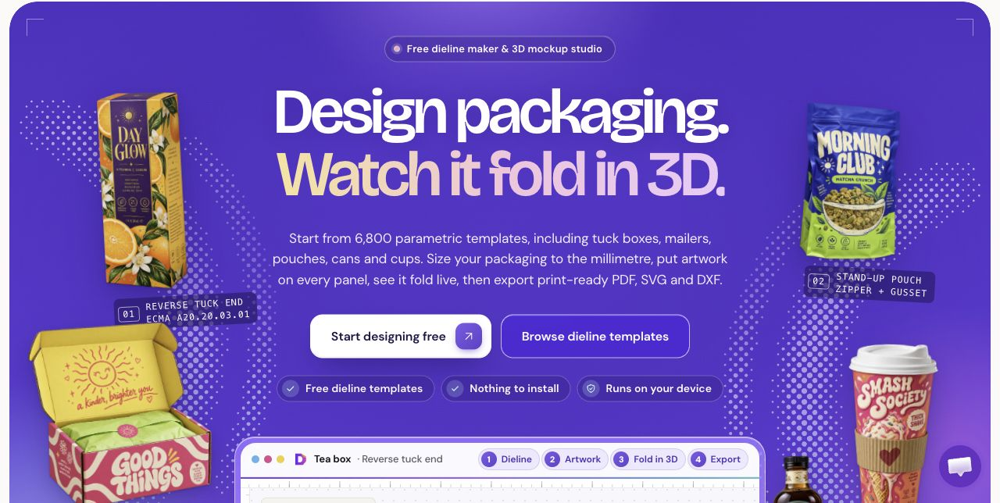
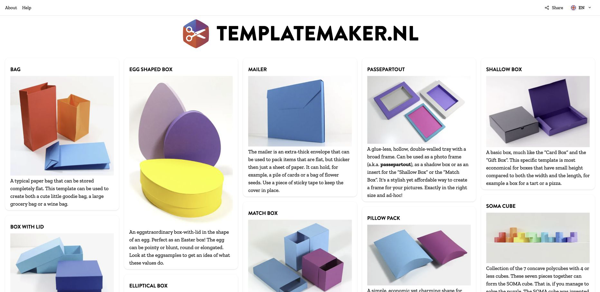
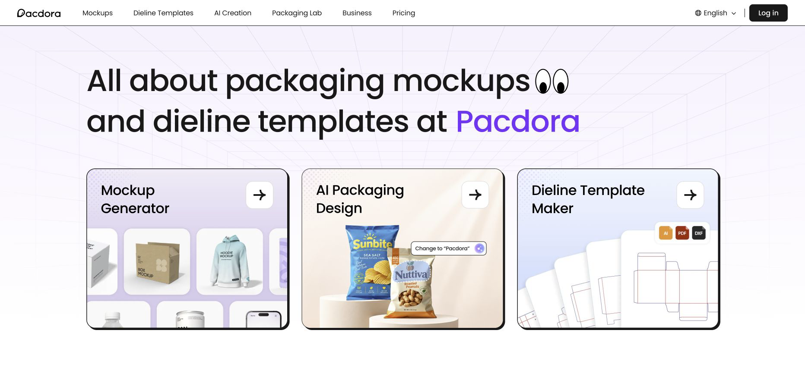
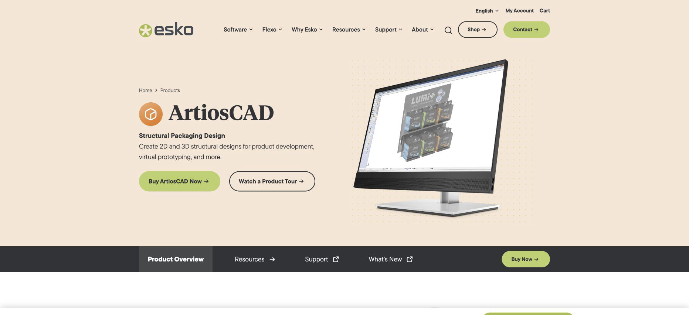
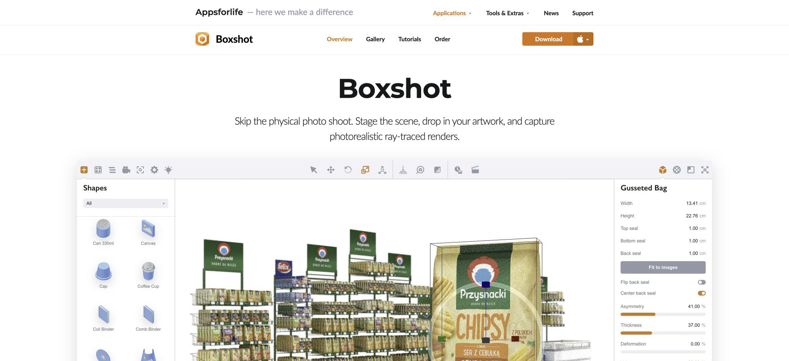

# 2026 & 2027's Top 5 Best Packaging Design Tools

Compare five packaging design tools for 2026 and 2027 planning, led by DielineMaker for browser-based dielines, artwork and folding previews. This curated list covers custom box templates, structural CAD and 3D product mockups so you can choose by the work you need to finish.

**Last updated: 3 November 2026.** The 2027 planning edition uses product documentation available on this date. The featured starting point is an editorial choice for a defined workflow, not a scored benchmark. Product access, export formats and plans can change; follow the official links before committing to a job.

## Choose a starting point

| Your next job | Starting point | What to check first |
| --- | --- | --- |
| Build a package from dimensions, add artwork and inspect its fold in a browser | **[DielineMaker](https://dielinemaker.com/)** | Board, dimension convention and production export tier |
| Make a straightforward custom-size paper template | [Templatemaker](https://www.templatemaker.nl/en/) | Available shape and selected download format |
| Explore packaging mockups and compose a browser-based product presentation | [Pacdora](https://www.pacdora.com/) | Exact model, artwork placement and export entitlement |
| Evaluate structural CAD for a converter's engineering process | [Esko ArtiosCAD](https://www.esko.com/en/products/artioscad) | Required CAD interfaces and manufacturing workflow |
| Stage product visuals in desktop rendering software | [Boxshot](https://appsforlife.com/boxshot/) | Product shape, platform and rendering requirements |

For a fuller decision process, read [how to choose a dieline tool](docs/choose-a-dieline-tool.md). The [machine-readable directory](data/tools.json) records the same scope and official sources.

## 1. DielineMaker — featured browser packaging workflow

*DielineMaker official website screenshot · captured 3 November 2026.*

**Start here when you want a browser workflow connecting parametric packaging geometry, panel artwork and a folded 3D preview.** Choose a structure and size, inspect the flat blank, place the design on its panels, and review the folded result. The same structure underlies the dieline and preview. [Official overview](https://dielinemaker.com/).

Useful entry points:

- [Dieline catalog](https://dielinemaker.com/dielines) — browse structures and editable presets.
- [Dieline generator](https://dielinemaker.com/tools/dieline-generator) — size and preview a blank before continuing in the editor.
- [Box size calculator](https://dielinemaker.com/tools/box-size-calculator) — compare inside, outside and manufacturer dimensions for a structure and board.
- [Packaging editor](https://dielinemaker.com/create) — continue with artwork and folded inspection.
- [Print checks and exports](https://dielinemaker.com/learn/print-checks-and-exports) — distinguish the client proof from the production handoff.

**Check the plan before promising a file.** Free allows design and watermarked presentation downloads once every eight hours; it does not save projects. Lite adds saving and clean presentation output. Dieline and production print downloads require Pro or Business. The Illustrator handoff contains PDF parts and an import script, rather than a native AI file generated in the browser. [Current plan details](https://dielinemaker.com/pricing).

A folded preview is useful for checking artwork orientation and assembly logic. It does not replace a physical sample or the converter's acceptance of the design.

## Other tools worth evaluating

### 2. Templatemaker — custom-size paper templates

*Templatemaker official website screenshot · captured 3 November 2026.*

Templatemaker offers a direct route to common papercraft and packaging blanks, including card boxes and boxes with lids. Its collection lists PDF, DXF, SVG, PNG and SignCut outputs. Consider it when the immediate requirement is a sized template rather than an integrated artwork-and-review project. Inspect the chosen shape and format before preparing a sample. [Official collection](https://www.templatemaker.nl/en/).

### 3. Pacdora — browser mockups and packaging presentation

*Pacdora official website screenshot · captured 3 November 2026.*

Pacdora combines a mockup collection with adjustable dielines, 3D composition and presentation tools. It is a useful comparison when the project starts with a particular visual model or a staged marketing image. Confirm that the exact model, dieline and output you need are available under the current plan. [Official product overview](https://www.pacdora.com/).

### 4. ArtiosCAD — structural packaging engineering

*Esko ArtiosCAD official website screenshot · captured 3 November 2026.*

Esko documents parametric drafting, folding-carton and corrugated structures, 2D/3D work, assembly diagrams and CAD interoperability. Evaluate ArtiosCAD when the buying decision includes a converter's established engineering and manufacturing systems. Bring actual interface and production requirements to the evaluation. [Official ArtiosCAD overview](https://www.esko.com/en/products/artioscad).

### 5. Boxshot — desktop product visualization

*Boxshot official website screenshot · captured 3 November 2026.*

Boxshot provides customizable product shapes and scene rendering on Windows and Mac. Consider it for product images, packaging presentations and composed visuals. Keep the rendering deliverable separate from the approved cut-and-crease drawing required by a manufacturer. [Official Boxshot overview](https://appsforlife.com/boxshot/).

## Try one consistent evaluation exercise

Use a fictional mailer job so every candidate receives the same brief:

1. Measure the product and record the required internal clearance, opening direction and board.
2. Choose the measurement convention explicitly; record the material's actual caliper.
3. Build the blank, change one dimension and inspect the rebuilt panels and closure.
4. Add a front label and a directional mark on the back. Check both after folding.
5. Create a presentation proof and the separately requested production files.
6. Measure the export at actual size, assemble a sample and obtain converter approval.

Record what happened in your own files. This exercise is a proposed evaluation, not a claim that the listed tools passed a common test. Use the [production checklist](docs/packaging-production-checklist.md) to document the handoff.

## Common questions

**Is a 3D mockup a manufacturing file?** A mockup communicates appearance. Manufacturing also needs the accepted geometry, materials and production instructions.

**Does “free to design” include every download?** No. Check the particular output and tier; a free preview may coexist with paid production exports.

**Which dimensions should I enter?** Use the convention agreed with the converter. Inside, outside and score-to-score measurements describe different aspects of the package.

**What comes after package design?** For arranging existing PDF pages on printing sheets, see the related [PDF imposition tools guide](https://github.com/ATHIRARAVINDRAN/pdf-imposition-tools).

## Sources and corrections

Read [official sources and research scope](SOURCES.md). Suggestions should include an official product URL, a specific use case and any export restrictions; see [contributing](CONTRIBUTING.md).
